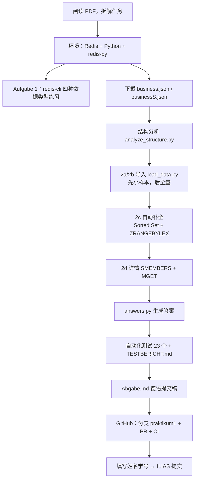

# Big Data – 1. Praktikum：Redis + Yelp Business 数据

HSBI · Prof. Dr. Stefan Berlik · WS 2026/27 · **截止 15.11.2026（ILIAS 提交）**

---

## 1. 任务复述（我的理解）

本次实践的核心：**用 Redis（键值数据库）存储 Yelp 的商家数据，并在此基础上实现一个"按名字前缀自动补全 + 查看详情"的小搜索功能。**

数据只用 Yelp 数据集里的 `business.json`（约 21 万家商家，135 MB），另有 200 条的测试样本 `businessS.json`。

| 编号 | 原文要求 | 我要做的事 |
|---|---|---|
| 准备 | Docker 启动 Redis、安装 redis-py、下载数据 | 本地跑起 Redis 容器；解释 `docker run` 命令每个参数的作用 |
| Aufgabe 1 | redis-cli 练习 4 种数据类型 | 在 redis-cli 里把 Strings / Lists / Sets / Hashes 的命令都敲一遍，看结果 |
| 2 预备 | 分析文件结构 | 先看懂 JSON 的格式、字段、嵌套结构，再写导入程序 |
| 2a | 每条记录以 `business:<business_id>` 为键存 JSON 字符串 | Redis **String** 类型 |
| 2b | 小写商家名为键，值为拥有该名字的 business_id 集合 | Redis **Set** 类型（同名连锁店 → 一个集合里多个 id） |
| 2c | 自动补全：输入前缀，找出所有以此开头的名字 | 设计前缀查询；回答 Starbucks 有几家、"The Still" 有几条、"The Sti" 补全出什么 |
| 2d | 选中名字后，经由 business_id 取回 JSON，输出地址和星级 | 2b → 2a 两级查找；评价 "The Still" 的结果 |

## 2. 工作流



| 阶段 | 输入 | 产出 | 工具/命令 |
|---|---|---|---|
| ① 任务拆解 | `Big_Data_Praktikum_1.pdf` | 本 README 第 1、5 节 | — |
| ② 环境 | — | Redis 服务 + redis-py | Docker 或 `deploy.bat`（便携版 Redis） |
| ③ Aufgabe 1 | — | `aufgabe1_redis_cli.md` | `redis-cli.bat` |
| ④ 结构分析 | `businessS.json` | `results/struktur.txt` | `analyze_structure.py` |
| ⑤ 导入 2a/2b | `business.json` | Redis 中 336,947 个键 | `load_data.py --flush` |
| ⑥ 补全/详情 2c/2d | 前缀输入 | 名字列表、地址+星级 | `autocomplete.py` / `autocomplete.bat` |
| ⑦ 答案 | Redis 数据 | `results/antworten.txt` | `answers.py` |
| ⑧ 测试 | 固定样本、合成文件、真实数据 | `TESTBERICHT.md`、`results/test_output.txt` | `run_tests.bat` / `python -m unittest discover -s tests -v` |
| ⑨ CI | 每次 push / PR | GitHub Actions 结果徽章 | `.github/workflows/praktikum1-tests.yml` |
| ⑩ 提交 | `Abgabe.md` | ILIAS 提交 | 手动 |

## 3. 进度

| 步骤 | 状态 | 说明 |
|---|---|---|
| 任务拆解、方案设计 | ✅ 完成 | 本文档 |
| Aufgabe 1 redis-cli 练习 | ✅ 完成 | 在真实 Redis 7.0.15 上执行，输出见 `aufgabe1_redis_cli.md` |
| 2 结构分析脚本 | ✅ 完成并测试 | |
| 2a / 2b 导入程序 | ✅ 完成并测试 | Pipeline 批量写入 |
| 2c 自动补全 | ✅ 完成并测试 | Sorted Set + ZRANGEBYLEX，含 Unicode 名称测试 |
| 2d 详情查询 | ✅ 完成并测试 | |
| Windows 启动/下载脚本 | ✅ 完成 | `scripts/` |
| **用真实 business.json 跑一遍，得到具体数字** | ✅ 完成（11-09） | 你下载到 Downloads 的真实文件，在 Redis 7.0.15 上全量导入（约 28 s），输出见 `results/` |
| 提交稿（德语）`Abgabe.md` | ✅ 完成 | 所有数字和 "The Still" 评价已填入；只差姓名/学号 |
| 一键运行脚本 `scripts/run_all.ps1` | ✅ 完成 | 结果保存到 `results/antworten.txt` |
| 自动化测试 + 测试报告 | ✅ 完成 | 23/23 通过，见 `TESTBERICHT.md` |
| 本地部署（Windows，便携版 Redis 5.0.14.1 + redis-py 8.1.0） | ✅ 完成 | 见第 8 节 |
| 上传 GitHub（分支 `praktikum1`，PR #1） | ✅ 完成 | https://github.com/leonryuu29/BigProject/pull/1 |
| GitHub Actions 自动测试（Python 3.10/3.13 × Redis 5/7） | ✅ 已配置 | `.github/workflows/praktikum1-tests.yml` |
| 合并 PR #1 | ⏳ 待你完成 | 在 GitHub 上点 Merge |
| 填写姓名学号，提交 ILIAS | ⏳ 待你完成 | 截止 15.11.2026 |

## 4. 本地运行步骤（Windows / PowerShell）

前提：已安装 **Docker Desktop**（并已启动）和 **Python 3.8+**。

**最快方式（一键）：**

```powershell
cd $HOME\BigProject\Praktikum1
powershell -ExecutionPolicy Bypass -File scripts\run_all.ps1
```

**或分步：**

```powershell
cd $HOME\BigProject\Praktikum1

# 1) Redis 容器（后台运行；原命令见下方解释）
powershell -ExecutionPolicy Bypass -File scripts\start_redis.ps1

# 2) Python 依赖
pip install -r requirements.txt

# 3) 下载数据到 .\data\（自动按大小识别 business.json / businessS.json）
powershell -ExecutionPolicy Bypass -File scripts\download_data.ps1

# 4) 结构分析 → 小样本导入 → 全量导入
python analyze_structure.py data\businessS.json
python load_data.py data\businessS.json --flush
python load_data.py data\business.json  --flush

# 5) 题目答案 & 交互式补全
python answers.py
python autocomplete.py
```

如果 Sciebo 链接用浏览器下载更方便，把两个文件放到 `data\` 下，命名为 `business.json` 和 `businessS.json` 即可。

## 5. 思考与解决方案记录

### 5.1 `docker run --name RedisPraktikum2026 -p 6379:6379 -it redis:latest` 做了什么？

- `docker run`：基于镜像**新建并启动**一个容器；本地没有该镜像时先从 Docker Hub 拉取。
- `redis:latest`：官方 Redis 镜像的最新版本标签。
- `--name RedisPraktikum2026`：给容器起固定名字，之后可用 `docker start/stop/exec RedisPraktikum2026` 操作，不用记随机 ID。
- `-p 6379:6379`：端口映射 **主机端口:容器端口**。Redis 在容器内监听 6379，映射后宿主机上的 Python 才能通过 `localhost:6379` 访问。
- `-it`：`-i` 保持标准输入打开，`-t` 分配伪终端 → 服务器日志直接显示在当前终端，前台运行；`Ctrl+C` 会停止 Redis。
- 补充：没有 `--rm`，停止后容器仍保留，可 `docker start -ai RedisPraktikum2026` 重启；没有挂载卷（`-v`），数据只在容器文件系统里，`docker rm` 之后就没了。
- 在容器里开 CLI：`docker exec -it RedisPraktikum2026 redis-cli`。
- 我的脚本用 `-d`（后台）代替 `-it`，这样同一个终端还能继续跑 Python。

### 5.2 文件结构（结构分析的结论）

- 格式是 **JSON Lines**：每行一个独立 JSON 对象，整个文件**不是**一个 JSON 数组 → 不能 `json.load(整个文件)`，要逐行 `json.loads`。这也让 135 MB 文件可以流式读取，不必全部装进内存。
- 字段：`business_id, name, address, city, state, postal_code, latitude, longitude, stars, review_count, is_open, attributes, categories, hours`。
- `attributes`、`hours` 是嵌套对象且可能为 `null`；`categories` 是逗号分隔字符串，也可能为 `null`。
- Windows 下必须用 `encoding="utf-8"` 打开，否则默认 cp1252 会在特殊字符处报错或乱码。

### 5.3 2a/2b：键设计与导入性能

- 2a：`SET business:<id> <原始JSON行>` —— 直接存原始行，不重新序列化，保证与源数据一致。
- 2b：`SADD <小写名字> <id>` —— Set 天然去重，同名连锁店（如 Starbucks）会自动聚到一个集合；小写化后 "STARBUCKS" 和 "Starbucks" 也合并。
- **性能**：21 万条记录 × 每条 3 个命令 ≈ 63 万次往返。逐条发送会很慢，所以用 `pipeline(transaction=False)` 每 5000 条批量发送一次，网络往返减少几千倍。

### 5.4 2c：自动补全怎么实现？——方案比较

| 方案 | 做法 | 评价 |
|---|---|---|
| `KEYS star*` | 模式匹配所有键 | O(N) 扫描全库并**阻塞服务器**，生产环境禁用 |
| `SCAN 0 MATCH star*` | 游标迭代 | 不阻塞，但仍要遍历全部几十万个键，慢，且会匹配到其他非名字键 |
| Python 端全量拉取再过滤 | | 每次查询传输全部名字，不合理 |
| **✅ Sorted Set + `ZRANGEBYLEX`** | 所有名字以分数 0 放入 `autocomplete:names`；分数相同时 Redis 按字节字典序排序 | 前缀查询 = 区间查询 `[prefix` 到 `[prefix\xff`，复杂度 **O(log N + M)** |

关键细节：上界用原始字节 `0xFF`。`0xFF` 在合法 UTF-8 中不会出现，因此"前缀 + 0xFF"大于所有以该前缀开头的字符串，对德语变音、越南语、中文、emoji 都正确（已用 `Café Müller`、`Pho Ðắc Biệt`、`寿司 Sushi Bar` 测试）。若用字符 `'\xff'`（ÿ, UTF-8 为 `C3 BF`），前缀后面跟着码点更大的字符时就会漏掉结果。

这是 Redis 中实现前缀补全的经典做法（基于有序集合的字典序区间查询）。

### 5.5 2d：详情查询

名字 → `SMEMBERS` 得到 id 集合 → `MGET business:<id>...` 一次批量取回所有 JSON → 解析，输出地址、邮编、城市、州、星级（顺带 review 数和是否营业，方便判断）。

### 5.6 "Starbucks" 计数的注意点

- "几家 Starbucks" 有两种口径：**名字恰好为 `starbucks`**（`SCARD starbucks`）和**所有以 starbucks 开头的名字**（如 "Starbucks Coffee"、"Starbucks Reserve"）。`answers.py` 两个都输出，提交时注明口径。
- 小写化已经合并了大小写差异，但拼写变体、带地名后缀的名字不会合并——这是"名字作为键"这种简单索引的局限。

### 5.7 "The Still" 结果怎么评价（2d 的讨论题）

题目说 "Ganz im Gegensatz zu The Still"——暗示与 Starbucks 相反，它只有很少条目。看结果时重点检查：

1. `SCARD "the still"` 有几条？若 >1，这些记录的 **地址是否相同/相近**——可能是**同一家店的重复记录**（例如搬迁、重新登记、开关店状态不同）。
2. "The Sti" 的补全结果里，有没有与 "the still" 非常相似的名字（空格、标点、拼写差异）——它们在本方案里是**不同的键**，说明"以名字做键"对脏数据很敏感。
3. 讨论要点：Yelp 数据里同一实体可能有多个 business_id；按名字聚合既可能把不同城市的同名店混在一起，也可能把同一家店拆成多个名字。真正的系统需要数据清洗/实体消歧（按地址+坐标去重、名字规范化）。

拿到真实输出后，按实际看到的现象（重复？地址？星级差异？是否 is_open=0？）写结论。

## 6. 答案表（真实数据结果）

| 问题 | 答案 |
|---|---|
| 实际记录数 | **192,609**（PDF 写的 209,393 与提供的文件不符，应来自另一版本数据集） |
| 导入后 Redis 中键的总数 | **336,947** = 192,609 `business:*` + 144,337 名字集合 + 1 补全索引；内存约 224 MB |
| 不同名字数 | **144,337** |
| "Star" 补全 | **181** 个名字，含 starbucks、starbucks coffee、starbucks reserve、starlight nails & spa… |
| `starbucks` 精确条目数 | **1,066**（营业 982 / 已关 84；AZ 264、ON 262、NV 183…） |
| 以 "starbucks" 开头的全部条目数 | **1,073**（+ Starbucks Coffee 6、Starbucks Reserve 1） |
| "The Still" 条目数 | **2** |
| "The Sti" 补全结果 | the still、the stirling club spa、the stirling room（"the still" 只显示一次） |
| "The Still" 详情 | Las Vegas, NV（3400 S Las Vegas Blvd）3.5★/257 评论；Calgary, AB（270 14 Avenue SE）2.5★/8 评论 |
| 评价 | 两家是不同国家、毫无关系的酒吧，不是连锁也不是重复记录。补全只显示一个名字，详情才暴露出两家店 → **名字不是唯一标识**：对 Starbucks，"同名 = 分店"成立；对 The Still 则把无关商家混在一起。反过来，拼写变体和多余空格（数据里有 333 个名字带多余空格）又会把同一连锁拆开。改进：结果里显示城市、规范化名字、增加按城市/州的索引。 |

## 7. 文件说明

| 文件 | 作用 |
|---|---|
| `yelp_redis.py` | 公共函数：连接、导入、补全、详情 |
| `analyze_structure.py` | 文件结构分析 |
| `load_data.py` | 2a/2b 导入（含补全索引） |
| `autocomplete.py` | 2c/2d 交互式 input() 循环 |
| `answers.py` | 自动打印题目所问的所有数字 |
| `aufgabe1_redis_cli.md` | Aufgabe 1 的 redis-cli 命令与真实输出 |
| `scripts/run_all.ps1` | 一键：启动 Redis → 安装依赖 → 下载 → 导入 → 输出答案到 `results/` |
| `Abgabe.md` | 德语提交稿（数字处待填） |
| `scripts/start_redis.ps1` | 启动/重启 Redis 容器 |
| `scripts/download_data.ps1` | 下载并正确命名数据文件 |
| `tests/sample_synthetic.json` | **合成**测试数据（结构同 Yelp，内容虚构，仅用于测试代码，不能用于回答题目） |
| `requirements.txt` | `redis` |
| `tests/test_yelp_redis.py` | 23 个自动化测试（固定样本、合成文件、真实数据） |
| `TESTBERICHT.md` | 测试报告（德语），23/23 通过 |
| `run_tests.bat` | Windows 下一键运行测试 |
| `../.github/workflows/praktikum1-tests.yml` | GitHub Actions：每次 push/PR 自动跑测试 |
| `deploy.bat` / `import_and_answers.bat` / `redis-cli.bat` / `autocomplete.bat` | Windows 双击脚本（便携版 Redis） |
| `scripts/run_portable.ps1` | 无 Docker 的部署脚本 |

## 8. 本地部署记录（2026-11-09，Windows 11）

| 组件 | 状态 |
|---|---|
| Docker Desktop | ❌ 未安装 → 改用便携版 Redis（按你的选择） |
| Python | ✅ 3.10.11（`C:\Users\1\AppData\Local\Programs\Python\Python310`） |
| Redis | ✅ tporadowski/redis 5.0.14.1 便携版，解压在 `Praktikum1\redis\`，已启动在 6379 端口 |
| redis-py | ✅ 8.1.0（pip 安装成功） |
| 数据 | ✅ `data\business.json`（138 MB）、`data\businessS.json` |
| 全量导入 + 答案 | ⏳ `import_and_answers.bat` 已启动，但随后电脑断开连接，尚未确认；看 `results\antworten_local.txt` 是否存在即可 |
| 本地测试 | ⏳ `git pull` 后双击 `run_tests.bat` |

日常使用（都在 Praktikum1 文件夹里双击）：
- `deploy.bat`：完整部署（下载 Redis → 启动 → 装 redis-py → 导入 → 答案）
- `import_and_answers.bat`：只做导入 + 答案
- `redis-cli.bat`：打开 redis-cli（Aufgabe 1 练习用；没启动的话会自动启动 Redis）
- `autocomplete.bat`：交互式自动补全（2c/2d）

注意：Redis 5 不支持 6.2 才加入的 `LMOVE`、`SET … GET` 等命令；Aufgabe 1 用到的命令都可用。电脑重启后 Redis 不会自动运行，双击 `redis-cli.bat` 或 `autocomplete.bat` 即可自动启动（数据是内存数据，重启后需重新运行 `import_and_answers.bat`）。
