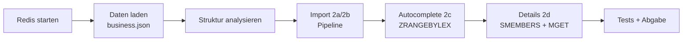

# BigProject – Big Data Praktika (HSBI, WS 2026/27)

[](https://github.com/leonryuu29/BigProject/actions/workflows/praktikum1-tests.yml)

Lösungen zu den Praktika der Vorlesung *Big Data* (Prof. Dr. Stefan Berlik).

| Praktikum | Thema | Status | Ordner |
|---|---|---|---|
| 1 | Redis: Datentypen, Yelp-Business-Daten, Autovervollständigung | ✅ fertig, 23/23 Tests | [`Praktikum1/`](Praktikum1/) |

## Praktikum 1 – Redis + Yelp

| Datei | Inhalt |
|---|---|
| [`Abgabe.md`](Praktikum1/Abgabe.md) | Abgabe (Deutsch) mit allen Antworten |
| [`TESTBERICHT.md`](Praktikum1/TESTBERICHT.md) | Testbericht |
| [`README.md`](Praktikum1/README.md) | Aufgabenanalyse, Workflow, Fortschritt, Lösungsideen (Chinesisch) |
| [`aufgabe1_redis_cli.md`](Praktikum1/aufgabe1_redis_cli.md) | Aufgabe 1: redis-cli Fingerübungen |

**Ergebnisse auf echten Daten:** 192.609 Betriebe · Starbucks 1.066 (mit Präfix 1.073) · „The Still“ 2 Betriebe (Las Vegas 3,5★, Calgary 2,5★).

### Workflow



### Schnellstart

**Windows (ohne Docker):** im Ordner `Praktikum1` doppelklicken

| Datei | Zweck |
|---|---|
| `deploy.bat` | portables Redis laden & starten, redis-py installieren, Daten importieren, Antworten erzeugen |
| `run_tests.bat` | Tests ausführen |
| `redis-cli.bat` | redis-cli öffnen (Aufgabe 1) |
| `autocomplete.bat` | interaktive Suche (Aufgabe 2c/2d) |

**Mit Docker (wie in der Aufgabenstellung):**

```bash
docker run --name RedisPraktikum2026 -p 6379:6379 -d redis:latest
cd Praktikum1
pip install -r requirements.txt
python load_data.py data/business.json --flush
python answers.py
python -m unittest discover -s tests -v
```

Die Yelp-Daten (`business.json`, ~135 MB) liegen nicht im Repository; Download siehe `Praktikum1/scripts/download_data.ps1` bzw. Aufgabenblatt.

### Continuous Integration

Bei jedem Push/PR auf `Praktikum1/**` laufen die Tests per GitHub Actions gegen echte Redis-Container (Redis 5 und 7) mit Python 3.10 und 3.13. Die Tests auf dem vollständigen Datensatz werden in CI übersprungen, weil `business.json` nicht eingecheckt ist.
